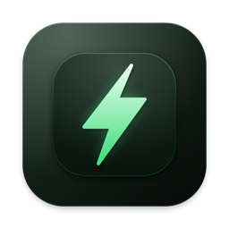
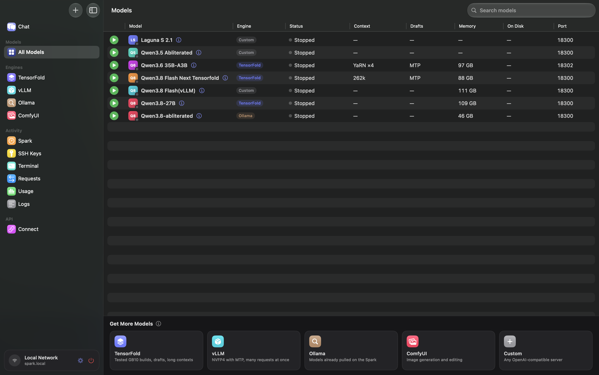
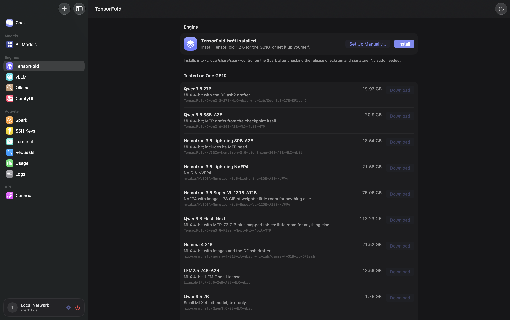
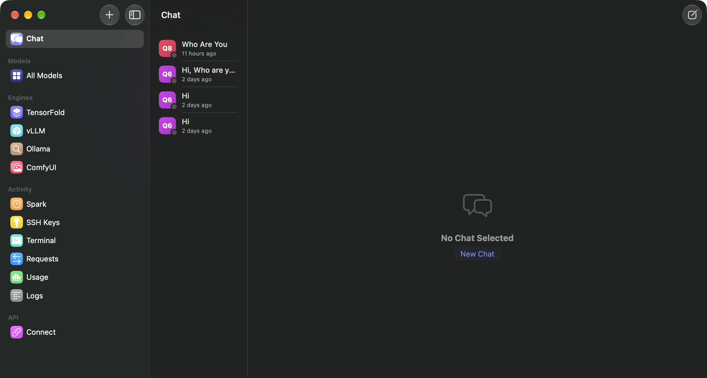
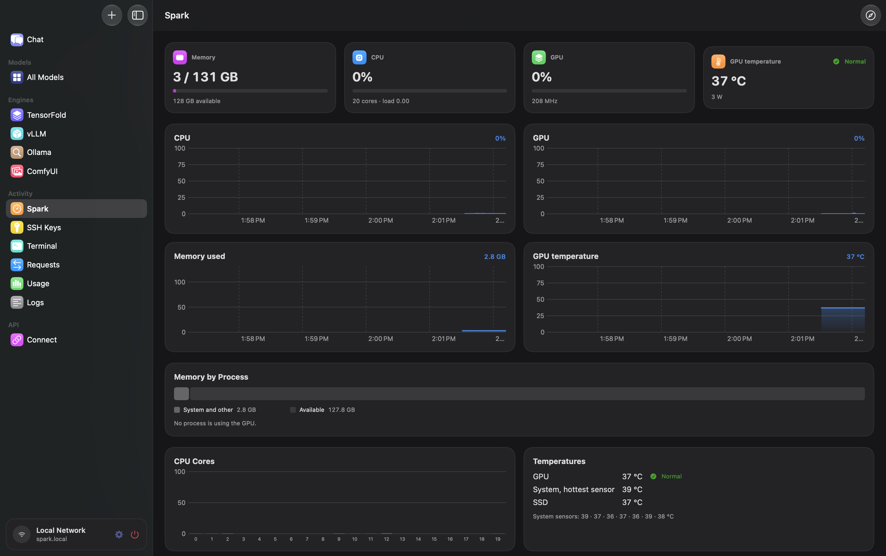
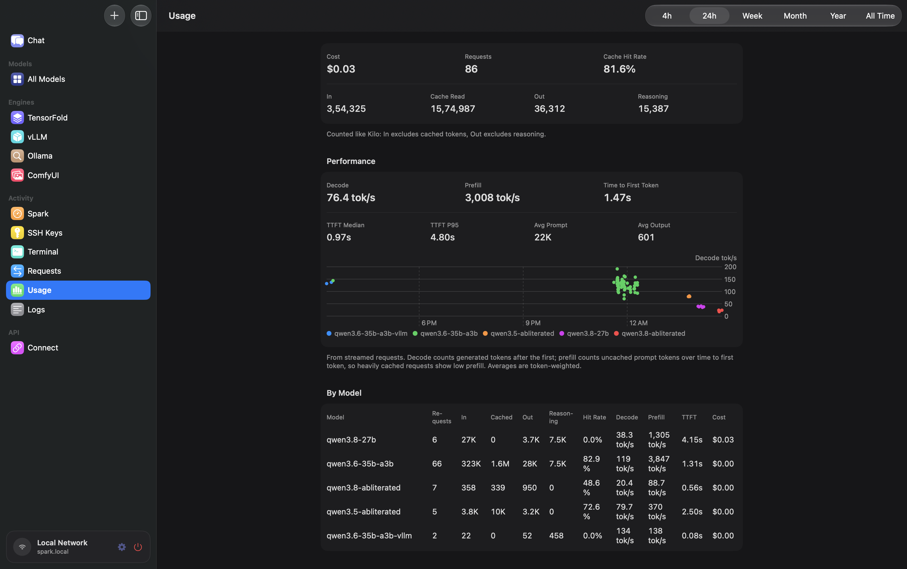
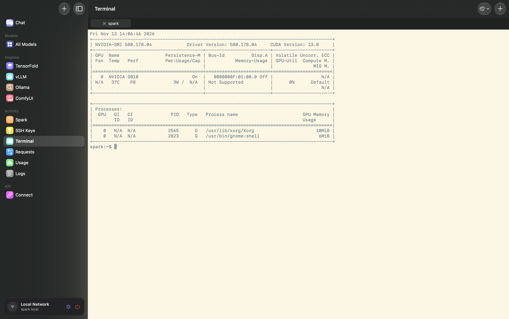

<div align="center">



# Spark Control

**Your NVIDIA DGX Spark, from your Mac.**

Start and switch local AI models with one click, chat with them, open a shell on the Spark,
and give every app on your Mac one OpenAI-compatible API.

[Download the latest release](https://github.com/abhilashiig/spark-control/releases/latest) · macOS 15+ · Apple Silicon

</div>

<p align="center">
  
</p>

---

## Why

A DGX Spark is a powerful box for running models, but using it day to day means SSH sessions, start
scripts, port numbers and remembering which model is running. Spark Control turns that into a Mac app:
pick a model, press play, and point your tools at `http://localhost:18080/v1`.

## What you can do

### 🚀 Run models
- **One table for every model**, whatever runs it. Start, stop and switch with a click.
- **Four engines:** **TensorFold** builds tested on the GB10, **vLLM** with NVFP4 models, **Ollama** models
  you've already pulled, and any **custom** server that speaks the OpenAI API.
- **Downloads happen on the Spark itself**, with progress in the app. Nothing big goes through your Mac.
- **Several models at once** when memory allows. When it doesn't, the app stops only what's in the way.
- **Per-model settings:** context window, speculative decoding, memory, and rules that fill in or override
  request parameters (say, a default temperature).



### 💬 Chat



Built-in chat with any of your models. Attach images, PDFs and text files, or paste a screenshot with ⌘V.
Chats get a title automatically, and you can edit and resend any message.

### 🔌 One API for everything
- An **OpenAI-compatible endpoint on your Mac** (`http://localhost:18080/v1`) that forwards to whichever
  model you ask for. **Ask for a model that's stopped and it starts automatically.**
- **Connect** gives you the URL, the API key and ready-to-paste code.
- **Coding tools set up in one click:** adds your models to **Kilo Code**, **Pi** and **Hermes**, with
  prices and whether each model reasons or takes images, and keeps them up to date.
- Only apps on your Mac can reach it, unless you choose to allow other devices.

### 📊 See what's happening



- **Spark:** live CPU, GPU, memory, power and temperatures, plus disk usage.
  The **DGX Dashboard** button opens NVIDIA's dashboard with no manual tunnel.
- **Requests:** every API call with its model, app, tokens, speed and errors, searchable.
- **Usage:** tokens, cache hits, decode and prefill speed, and what it would have cost, by model and app.
- **Benchmark** a model on the Spark: prefill and decode speed across context lengths and batch sizes.
- A **menu bar icon** shows what's running and lets you stop a model or copy the API URL.



### 🖥️ Work on the Spark



- **Terminal:** real shells on the Spark in tabs, with colour, mouse and resizing, so vim, htop and tmux
  just work. Five colour themes and the shortcuts you know from Terminal.app (⌘T, ⌘W, ⌘K, ⌘1–9, ⌘+ ⌘−).
- **SSH Keys:** see every key that can log in to your Spark, when and from where each last did, and
  remove any you don't recognise.
- **ComfyUI** for image generation: installed and started on the Spark, opened in your browser.

## Getting started

1. **Download** `SparkControl-vX.Y.Z.dmg` from [Releases](https://github.com/abhilashiig/spark-control/releases/latest)
   and drag the app to Applications.
2. **Open it** and enter your Spark's hostname and your login on it. The hostname is the name you'd use
   with `ssh`, without `.local`.
3. **Connect.** If you've never logged in to the Spark with a key, enter your password once and the app
   installs this Mac's SSH key. The password is never stored.
4. **Get a model:** pick an engine under *Get More Models*, download one, then press ▶︎.

> [!TIP]
> At home the app uses `<hostname>.local`. Away from home it switches to `<hostname>` over
> [Tailscale](https://tailscale.com) on its own.

## Use it from other apps

Any app that accepts a custom OpenAI endpoint works. Model names and the key are on the Connect page.

```bash
curl http://localhost:18080/v1/chat/completions \
  -H "Authorization: Bearer $SPARK_CONTROL_KEY" \
  -H "Content-Type: application/json" \
  -d '{"model": "qwen3.8-27b", "messages": [{"role": "user", "content": "Hello!"}]}'
```

```python
from openai import OpenAI

client = OpenAI(base_url="http://localhost:18080/v1", api_key="<key from the Connect page>")
reply = client.chat.completions.create(model="qwen3.8-27b", messages=[{"role": "user", "content": "Hello!"}])
print(reply.choices[0].message.content)
```

## Privacy and security

- **Everything stays between your Mac and your Spark.** No accounts, no telemetry, no cloud.
- The app reaches the Spark over **SSH with your own key**, and its models over your network or Tailscale.
- **Services without a login stay private:** ComfyUI and the DGX Dashboard listen only on the Spark itself
  and are reached through SSH tunnels.
- **Nothing is installed on the Spark unless you ask for it**, and nothing needs `sudo`.
- **Costs are estimates** from the prices you set. Nothing is billed.

Settings, chats and usage history live in `~/Library/Application Support/Spark Control/`.

## Build from source

Needs the Swift 6 toolchain (Xcode 16 or later).

```bash
./build-app.sh --install   # builds, copies to /Applications and launches it
./Tests/run.sh             # runs the self-check
```

Pushing a `vX.Y.Z` tag builds a DMG and publishes a release. Changes are listed in [CHANGELOG.md](CHANGELOG.md).
