<div align="center">

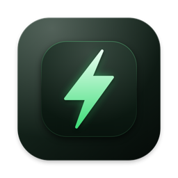

# Spark Control

### Your DGX Spark, as if it were part of your Mac.

Big local models, one click away. No SSH, no start scripts, no port numbers.

**[Download for Mac](https://github.com/abhilashiig/spark-control/releases/latest)** · macOS 15+ · Apple Silicon · Free and open source

</div>

<p align="center">
  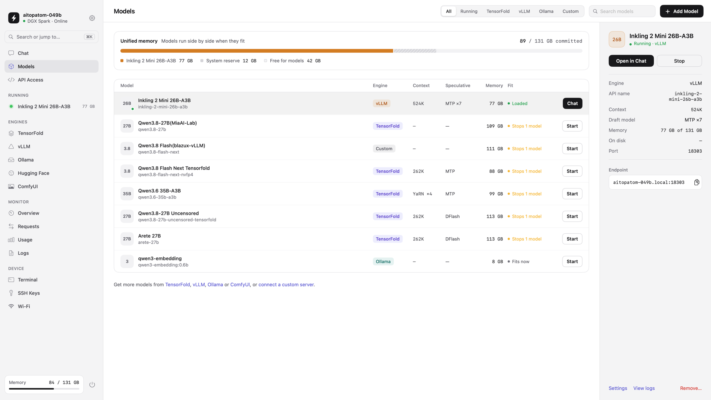
</p>

## The idea

Plenty of long-time Mac users would rather not live with anything that isn't a Mac. The DGX Spark is hard
to pass up anyway: a lot of AI for the money in a small, quiet box on your desk, with 128 GB of memory for
models a laptop can't hold, and prompt processing fast enough that long coding-agent prompts don't keep
you waiting. Out of the box, though, it's a Linux machine: SSH sessions, Docker commands,
start scripts and port numbers.

So what if it were simply part of your Apple setup?

**Spark Control makes it disappear behind your Mac.** Press ▶︎ and a model is running. Chat with it in a
native app. Point Kilo Code, Pi or any OpenAI app at `localhost`, and it answers as if the model lived on
your Mac, while the Spark does the heavy lifting.

📱 **Coming next:** an iPhone app, so your Spark comes with you too.

| On your own | With Spark Control |
|---|---|
| Install vLLM, TensorFold and ComfyUI by hand | One click each, on the Spark |
| Hunt for flags, quantizations and drafts that work on a GB10 | Models come tuned and measured on one |
| SSH in, find the start script, remember the flags | Press ▶︎ |
| Which model is running? On which port? | One table, one URL: `http://localhost:18080/v1` |
| Guess what fits in memory, stop the old model by hand | It shows what fits and stops only what's in the way |
| Edit every coding tool's config for each new model | Kilo Code, Pi and Hermes set up and kept in sync |
| `htop`, `nvidia-smi` and `df` in three terminals | Live CPU, GPU, memory, temperatures and disk on one page |
| "How fast is it really?" | Every request's speed, tokens and cost, as it happens |

<p align="center"><b>Get started in three steps:</b> connect to your Spark → install an engine and download a model → press ▶︎.</p>

## What you can do

### 🚀 Run models
- **One table for every model**, whatever runs it. Start, stop and switch with a click.
- **Four engines, each installed on the Spark with one click:** **TensorFold**, **vLLM**, **Ollama** (search
  ollama.com for sizes that fit the Spark's memory and pull them), and any **custom** server that speaks the OpenAI API.
- **Models tuned for the Spark:** the TensorFold and vLLM catalogs list models tested on a GB10, each with
  the quantization, speculative decoding, context window and memory that worked best there, and notes on the
  speed measured. Download, press ▶︎, and it starts with those settings.
- **Downloads happen on the Spark itself**, with progress in the app. Nothing big goes through your Mac.
- **Hugging Face:** search Hugging Face and download any model straight onto the Spark. See everything in its
  model cache, what's downloading and what's in use, and delete what isn't. Install the `hf` tool and sign the Spark in to Hugging Face for gated models, all from the app.
- **Several models at once** when memory allows. When it doesn't, the app stops only what's in the way.
- **Per-model settings:** context window, speculative decoding, memory, and rules that fill in or override
  request parameters (say, a default temperature).

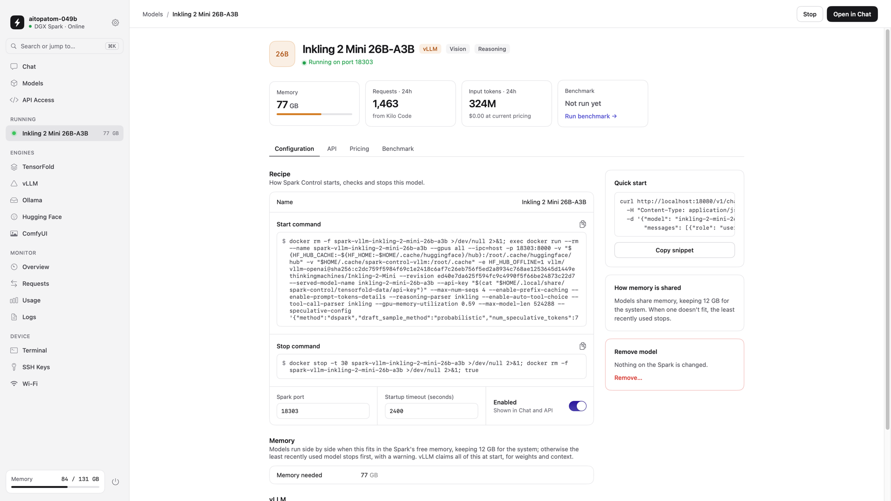

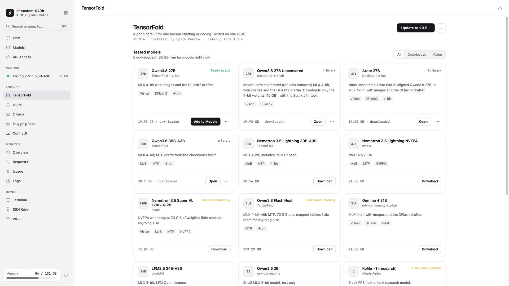

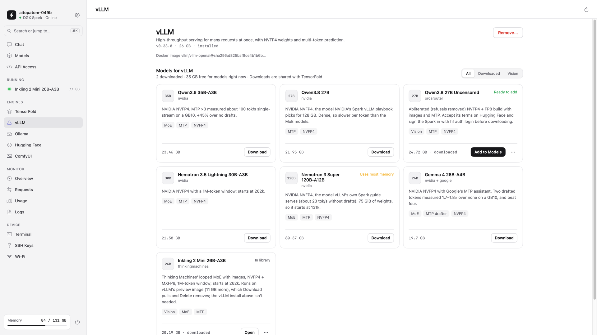

### 💬 Chat
Built-in chat with any of your models. Attach images, PDFs and text files, or paste a screenshot with ⌘V.
Chats get a title automatically, and you can edit and resend any message.

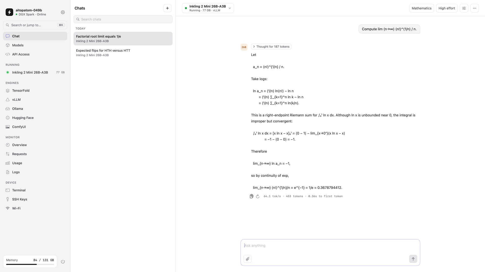

### 🔌 One API for everything
- An **OpenAI-compatible endpoint on your Mac** (`http://localhost:18080/v1`) that forwards to whichever
  model you ask for. **Ask for a model that's stopped and it starts automatically.**
- **API Access** gives you the URL, the API key and ready-to-paste code.
- **Coding tools set up in one click:** adds your models to **Kilo Code**, **Pi** and **Hermes**, with
  prices and whether each model reasons or takes images, and keeps them up to date. One more click points
  Kilo Code's codebase indexing at a small embedding model on the Spark, pulled with Ollama.
- Only apps on your Mac can reach it, unless you choose to allow other devices.

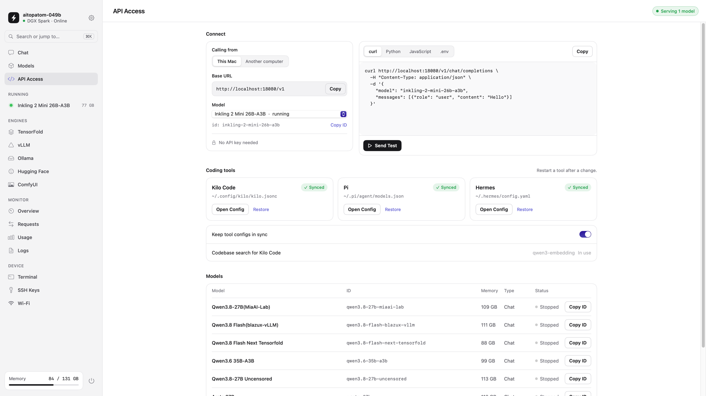

### 📊 See what's happening

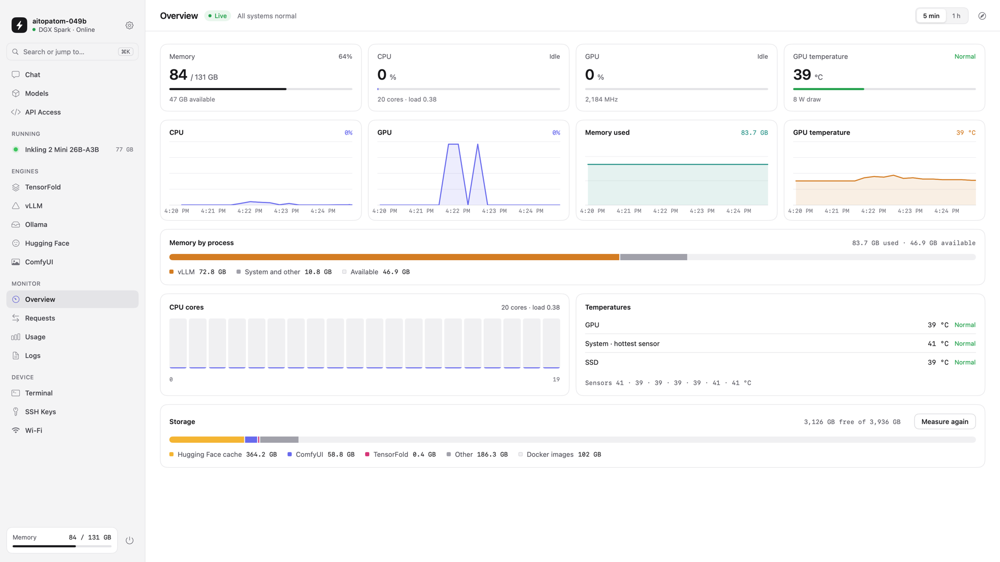

- **Overview:** live CPU, GPU, memory, power and temperatures, plus disk usage.
  The **DGX Dashboard** button opens NVIDIA's dashboard with no manual tunnel.
- **Requests:** every API call with its model, app, tokens, speed and errors, searchable.
- **Usage:** tokens, cache hits, decode and prefill speed, and what it would have cost, by model and app.
- **Benchmark** a model on the Spark: prefill and decode speed across context lengths and batch sizes.
- A **menu bar icon** shows what's running and lets you stop a model or copy the API URL.

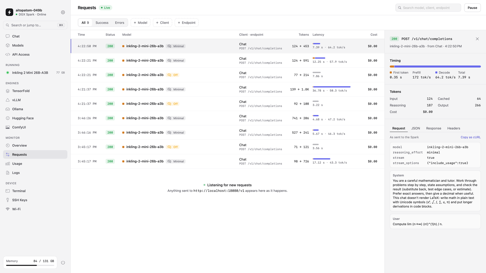

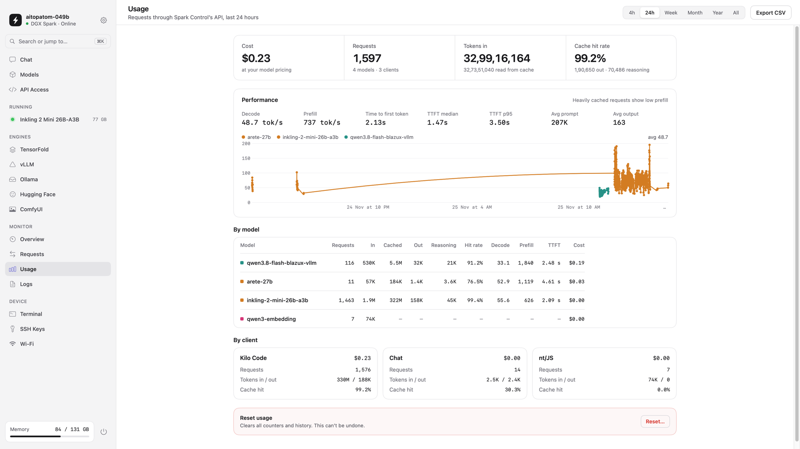

### 🖥️ Work on the Spark

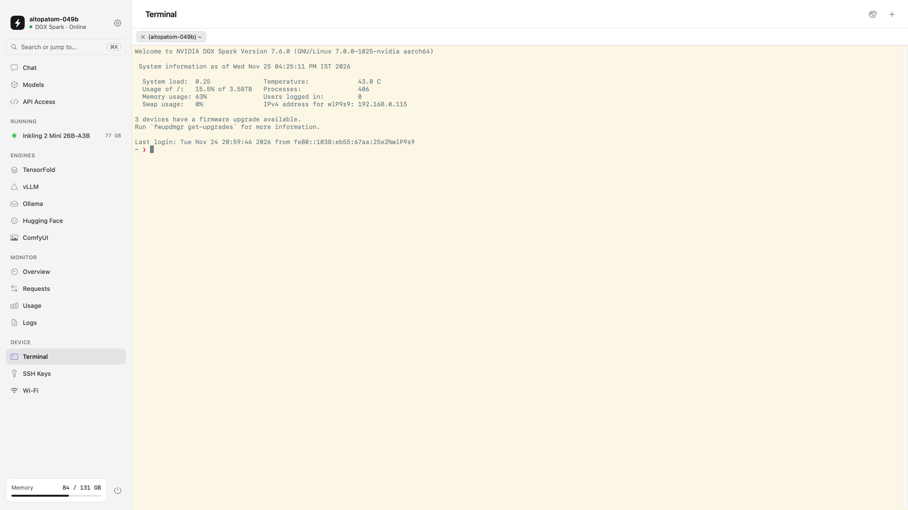

- **Terminal:** real shells on the Spark in tabs, with colour, mouse and resizing, so vim, htop and tmux
  just work. Five colour themes and the shortcuts you know from Terminal.app (⌘T, ⌘W, ⌘K, ⌘1–9, ⌘+ ⌘−).
- **SSH Keys:** see every key that can log in to your Spark, when and from where each last did, and
  remove any you don't recognise.
- **Wi-Fi:** see the networks your Spark can reach and switch it to another. You're warned first when the
  switch could cut you off (you reach it over that Wi-Fi, or over Tailscale riding on it), and a network it
  can't join sends it back to the one it was on.
- **ComfyUI** for image generation: installed and started on the Spark, opened in your browser.

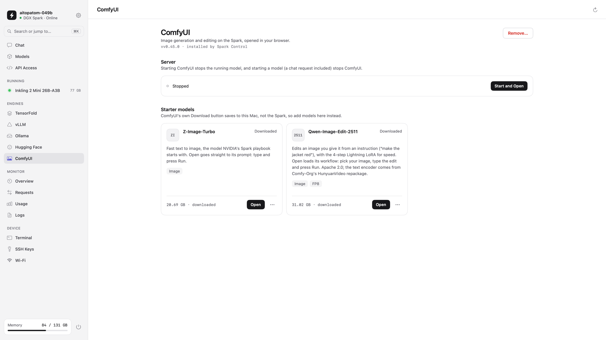

## Getting started

1. **Download** `SparkControl-vX.Y.Z.dmg` from [Releases](https://github.com/abhilashiig/spark-control/releases/latest)
   and drag the app to Applications.
2. **Open it** and enter your Spark's hostname and your login on it. The hostname is the name you'd use
   with `ssh`, without `.local`.
3. **Connect.** If you've never logged in to the Spark with a key, enter your password once and the app
   installs this Mac's SSH key. The password is never stored.
4. **Get a model:** pick an engine under *Get More Models*, download one, then press ▶︎.

> [!TIP]
> At home the app uses `<hostname>.local`. Away from home it switches to `<hostname>` over
> [Tailscale](https://tailscale.com) on its own.

## Use it from other apps

Any app that accepts a custom OpenAI endpoint works. Model names and the key are on the API Access page.

```bash
curl http://localhost:18080/v1/chat/completions \
  -H "Authorization: Bearer $SPARK_CONTROL_KEY" \
  -H "Content-Type: application/json" \
  -d '{"model": "qwen3.8-27b", "messages": [{"role": "user", "content": "Hello!"}]}'
```

```python
from openai import OpenAI

client = OpenAI(base_url="http://localhost:18080/v1", api_key="<key from the API Access page>")
reply = client.chat.completions.create(model="qwen3.8-27b", messages=[{"role": "user", "content": "Hello!"}])
print(reply.choices[0].message.content)
```

## Privacy and security

- **Everything stays between your Mac and your Spark.** No accounts, no telemetry, no cloud.
- The app reaches the Spark over **SSH with your own key**, and its models over your network or Tailscale.
- **Services without a login stay private:** ComfyUI and the DGX Dashboard listen only on the Spark itself
  and are reached through SSH tunnels.
- **Nothing is installed on the Spark unless you ask for it**, and only Ollama's installer needs `sudo`
  (your password is used once and never stored).
- **Costs are estimates** from the prices you set. Nothing is billed.

Settings, chats and usage history live in `~/Library/Application Support/Spark Control/`.

## Build from source

Needs the Swift 6 toolchain (Xcode 16 or later).

```bash
./build-app.sh --install   # builds, copies to /Applications and launches it
./Tests/run.sh             # runs the self-check
```

Pushing a `vX.Y.Z` tag builds a DMG and publishes a release. Changes are listed in [CHANGELOG.md](CHANGELOG.md).

## License

Spark Control is open source under the [BSD 3-Clause License](LICENSE.md): use, modify and share it,
commercially or not, as long as you keep the copyright notice.

Contact: [hello@grabians.com](mailto:hello@grabians.com) ·
[grabians.com](https://grabians.com) (Grabians Connected LLP) ·
[grabconnected.com](https://grabconnected.com) (Grab Connected Tech Inc.)

The name and logo are not covered by the license; see [TRADEMARKS.md](TRADEMARKS.md).
Contributions need a signed CLA; see [CONTRIBUTING.md](CONTRIBUTING.md).
